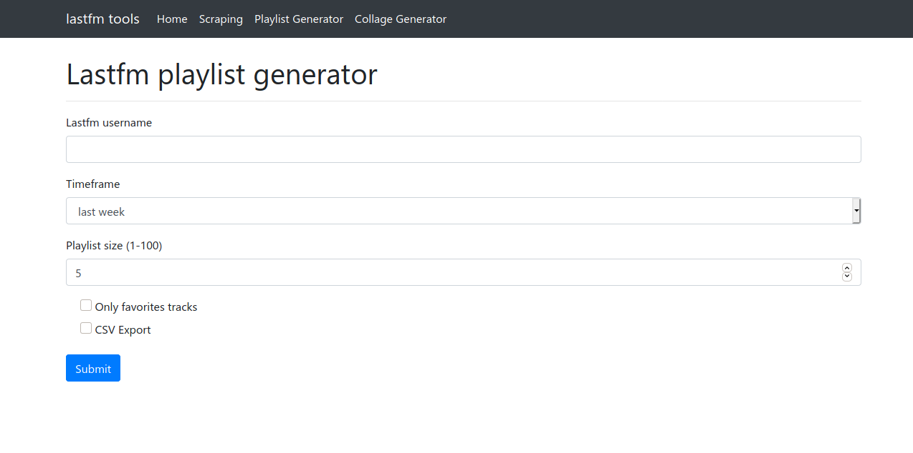

# django-lastfm

<a href="pictures/image.png"></a>

Simple django site acting as a frontend for:

- [lastfm_cg](https://github.com/dbeley/lastfm_cg): Last.fm collage generator
- [lastfm_pg](https://github.com/dbeley/lastfm_pg): Last.fm playlist generator
- [lastfm-wordcloud](https://github.com/dbeley/lastfm-wordcloud): Last.fm wordcloud generator
- [lastfm-scraper](https://github.com/dbeley/lastfm-scraper): Some lastfm scripts

## Deployment Options

### NixOS (Recommended for NixOS users)

This project includes a NixOS module for easy declarative deployment. See [NIXOS.md](NIXOS.md) for detailed instructions.

Quick start with flakes:
```bash
# Development environment
nix develop

# Build the package
nix build

# Add to your NixOS configuration - see NIXOS.md and example-configuration.nix
```

### Docker

Use the provided `docker-compose.yml` for containerized deployment. See the Docker section below for details.

### Manual/Traditional Deployment

Follow the configuration steps below using `.ini` files or environment variables.

## Secrets

To run the website, you will need some config files.

### secret.ini
```
[django]
SECRET_KEY = secret_key_here
```

### config_lastfm.ini
```
[lastfm]
username=username_here
api_key=api_key_here
api_secret=api_secret_here
```

### .env file

```
REDIS_URL=redis://domain.tld
# optional, for docker + traefik
DEFAULT_NETWORK=traefik-network
DOMAIN=domain.tld
ALLOWED_HOSTS='127.0.0.1 localhost domain.tld'
```

### Environment variables

If you can't use ini files (i.e. when deploying with heroku), you can use those environment variables:

- `PYLAST_USERNAME`
- `PYLAST_API_KEY`
- `PYLAST_API_SECRET`
- `DJANGO_SECRET_KEY`
- `REDIS_URL`

## Docker Deployment

The project includes Docker support with `Dockerfile` and `docker-compose.yml`:

```bash
# Build and run with docker-compose
docker-compose up -d
```

This will start:
- Redis container for Celery
- Django web server with Gunicorn
- Celery worker for background tasks

